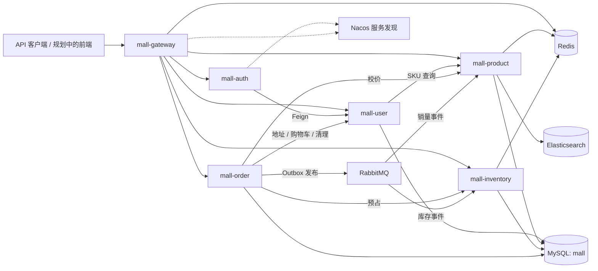

# NovaMall

基于 Spring Cloud Alibaba 的商城后端项目，围绕商品、SKU、购物车、订单和库存构建交易流程，实践服务端校价、订单快照、库存预占、消息 Outbox 和请求幂等。

当前处于后端迭代阶段，已实现基础交易逻辑和自动化测试，尚未完成独立前端、真实支付及生产环境验收。详细设计过程见 [后端改造记录](BACKEND_PROGRESS.md)。

## 目录

- [技术栈](#技术栈)
- [架构与模块](#架构与模块)
- [功能状态](#功能状态)
- [核心设计](#核心设计)
- [本地启动](#本地启动)
- [接口与请求示例](#接口与请求示例)
- [测试与验证](#测试与验证)
- [监控与接口文档](#监控与接口文档)
- [已知限制与路线图](#已知限制与路线图)

## 技术栈

| 技术 | 当前版本 / 用途 |
| --- | --- |
| Java / Maven | 源码和字节码目标 17，本地使用 OpenJDK 25；Maven 3.9+ |
| Spring Boot | 3.3.6 |
| Spring Cloud / Alibaba | 2023.0.3 / 2023.0.3.2 |
| Gateway / OpenFeign / Nacos | API 网关、服务间调用、服务注册与发现；Nacos 2.4.3 |
| MyBatis-Plus / MySQL | 3.5.7 / 8.4，业务持久化、条件更新和事务 |
| Redis | 7.4，商品缓存、排行榜、网关限流、秒杀 Lua 脚本 |
| RabbitMQ | 4.0，订单事件与秒杀消息 |
| Elasticsearch | 8.15.0，商品搜索 |
| JWT / BCrypt | 登录令牌和密码哈希 |
| JUnit 5 / Mockito / MockMvc | 单元测试、入参校验和接口契约测试 |
| Actuator / Micrometer / Prometheus / Grafana | 健康检查、指标采集和展示 |

Compose 同时提供 MinIO 开发实例，商品图片上传业务尚未接入。

## 架构与模块



图中展示主要业务依赖，Nacos 用于各服务的注册与发现。服务按领域拆分，目前共用一个 MySQL 数据库；跨领域业务查询主要通过 Feign 调用。

| 模块 | 端口 | 职责 |
| --- | --- | --- |
| `mall-gateway` | 8080 | 路由、JWT 验证、部分路由限流、Trace ID |
| `mall-auth` | 8081 | 登录和令牌签发 |
| `mall-user` | 8082 | 注册、收货地址、购物车 |
| `mall-product` | 8083 | 分类、商品、SKU 查询、搜索和排行榜 |
| `mall-inventory` | 8084 | 库存预占、释放、确认及秒杀实验流程 |
| `mall-order` | 8085 | 下单、购物车结算、订单状态、Outbox 与清理任务 |
| `mall-common` | - | 通用响应、Web、认证工具、ID、Redis、消息等公共模块 |

```text
NovaMall/
├── mall-common/          公共模块
├── mall-gateway/         API 网关
├── mall-auth/            认证服务
├── mall-user/            用户服务
├── mall-product/         商品服务
├── mall-inventory/       库存服务
├── mall-order/           订单服务
├── database/init/       初始化与升级 SQL
├── scripts/             PowerShell 联调脚本
├── monitoring/          Prometheus / Grafana 配置
├── .github/workflows/   CI 配置
├── docker-compose.yml   本地基础设施
└── BACKEND_PROGRESS.md  设计演进与验证记录
```

## 功能状态

“已实现”表示存在业务代码；实际数据库和跨服务验证范围见[测试与验证](#测试与验证)。

| 领域 | 已实现 | 待完善 |
| --- | --- | --- |
| 用户与认证 | 注册、BCrypt 密码哈希、JWT 登录、网关注入用户身份 | 用户资料管理、管理员授权、内部服务认证 |
| 地址 | 新增、列表、删除、下单时校验归属并保存快照 | 编辑、默认地址切换及并发唯一性 |
| 商品 | 分类/商品 CRUD、上下架、默认 SKU、已有多 SKU 查询 | 多规格管理、图片管理、描述/主图/划线价写入接口 |
| 搜索与排行 | Elasticsearch 搜索、异常时 MySQL 回退、Redis 热度/销量排行 | 索引可靠同步、销量去重和计数原子性 |
| 购物车 | SKU 引用、增删改、单项勾选、版本化更新、选中项结算 | 实时价格/库存汇总、全选 |
| 库存 | SKU 预占、释放、确认、条件更新与版本检查 | 持久化故障补偿、对账、SKU 并发集成验证 |
| 订单 | 创建、分页、查询、取消、超时取消、商品/地址快照、Mock 状态流转 | 完整详情 DTO、操作列表、金额展示、状态历史 |
| 支付与物流 | Mock 支付/发货/收货，支付和物流表结构 | 独立记录写入、真实支付、物流回调 |
| 工程支持 | Trace ID、Outbox 发布重试、Actuator、CI、联调脚本 | 完整集成测试、故障演练、生产部署配置 |

## 核心设计

### SKU 校价与订单快照

下单只接受商品引用和数量。服务端从商品服务读取当前 SKU 信息，校验上架状态与价格，再合并数量并预占库存：

- 同一 SKU 的重复行合并；同商品不同 SKU 独立计价和预占。
- 旧 `productId` 下单请求解析为该商品的默认 SKU，每项只能提交 `productId` 或 `skuId` 之一。
- 订单项保存商品名称、主图、规格、成交价快照，历史订单不依赖商品当前信息。
- 金额计算使用 `BigDecimal`；订单地址复制下单时的收货信息。
- 下单校价走数据库 SKU 查询，不使用商品浏览缓存。

### 库存与订单事件

库存通过数量条件和版本号更新，预占记录按订单与 SKU 标识。支付事件确认库存，取消事件释放库存。

订单变更与 Outbox 记录在同一个本地事务中写入；发布器使用 RabbitMQ publisher confirm、路由返回检查和退避重试。该机制不等同于跨服务事务：进程崩溃、远程超时后延迟提交或释放失败，仍需后续补偿与对账覆盖。

### 购物车结算与重试

`POST /api/orders/checkout` 从用户服务读取当前选中项，通过用户 ID 与 UUID `requestKey` 识别一次结算意图。

- 相同用户、相同键的成功请求重试返回原订单；同键换地址会被拒绝。
- 订单、结算记录、购物车清理任务在同一个本地事务中保存。
- 后台任务在提交后调用用户服务清理购物车，失败后退避重试。
- 清理要求购物车项的原版本匹配；结算期间被修改的行会保留。

前端应为一次结算生成一个键，并在所有重试中保留它。不同键表示不同请求；旧的直接下单接口尚未提供同等请求去重能力。

## 本地启动

### 1. 准备环境

- IntelliJ IDEA，推荐使用已验证的 OpenJDK 25。
- Maven 3.9+。
- Docker Desktop / Docker Engine 和 Compose v2。
- PowerShell，用于执行仓库中的联调脚本。

```powershell
git clone https://github.com/Bryce-border/NovaMall.git
cd NovaMall
java -version
mvn -version
```

IntelliJ 中打开根 `pom.xml`，将 Project SDK 和 Maven Runner JRE 设置为 OpenJDK 25。终端运行 Maven 时也需确认 `JAVA_HOME` 指向所选 JDK。POM 的源码和字节码目标目前仍为 Java 17。

### 2. 启动基础设施

```powershell
docker compose up -d
docker compose ps
```

Compose 仅启动基础设施，Java 服务需要另行启动。

| 组件 | 本地入口 |
| --- | --- |
| MySQL | `localhost:3307`，库名 `mall`；容器内端口为 3306 |
| Redis | `localhost:6379` |
| Nacos | [localhost:8848/nacos](http://localhost:8848/nacos) |
| RabbitMQ | AMQP `localhost:5672`；[管理界面](http://localhost:15672) |
| Elasticsearch | [localhost:9200](http://localhost:9200) |
| MinIO | API `localhost:9000`；[控制台](http://localhost:9001) |
| Prometheus | [localhost:9090](http://localhost:9090) |
| Grafana | [localhost:3000](http://localhost:3000) |

默认开发配置为 MySQL `root/root`、RabbitMQ `novamall/novamall`、MinIO `novamall/novamall123`。这些配置用于本地开发；当前服务认证和管理员权限尚未完善，不应直接暴露到公网。

### 3. 初始化或升级数据库

新 MySQL 数据卷会按文件名顺序执行 [database/init](database/init) 中的 SQL。已有数据卷不会因重启 Compose 自动升级。

| 脚本 | 用途 |
| --- | --- |
| `001` 至 `004` | 用户、商品、库存、订单基础表 |
| [005-order-outbox.sql](database/init/005-order-outbox.sql) | 订单消息 Outbox |
| [006-seckill.sql](database/init/006-seckill.sql) | 秒杀记录 |
| [007-mall-model-upgrade.sql](database/init/007-mall-model-upgrade.sql) | 模型扩展、默认 SKU 回填和历史库存迁移 |
| [008-cart-checkout.sql](database/init/008-cart-checkout.sql) | 购物车版本、结算请求和清理任务 |

已有开发库应先备份、停止业务写入，确认基础脚本已执行，再依次执行 007、008。可在 IntelliJ Database 或 MySQL 客户端连接 `mall` 库执行。

**007、008 尚未完成真实 MySQL 的首次执行、重复执行及旧数据升级验收。** MySQL DDL 可能隐式提交，应先在隔离数据库验证，不能将这些脚本视为已验证的生产迁移方案。

### 4. 构建并启动服务

```powershell
mvn clean verify
```

该命令执行当前自动化测试并打包，不要求先启动业务服务。随后在 IntelliJ 中依次运行：

```text
MallUserApplication
MallProductApplication
MallInventoryApplication
MallAuthApplication
MallOrderApplication
MallGatewayApplication
```

默认配置适用于 Java 服务在宿主机运行、基础设施在 Compose 中运行的方式。常用配置如下：

| 环境变量 | 作用 |
| --- | --- |
| `MYSQL_HOST` / `MYSQL_PORT` | 默认 `localhost:3307`；应用容器内应使用 `mysql:3306` |
| `MYSQL_USERNAME` / `MYSQL_PASSWORD` | Java 服务数据库凭据 |
| `MYSQL_ROOT_PASSWORD` | Compose MySQL 初始化密码；修改时需同步 Java 服务配置 |
| `NACOS_ADDR` | 默认 `localhost:8848` |
| `REDIS_HOST` / `REDIS_PORT` | 默认 `localhost:6379` |
| `RABBITMQ_HOST` / `RABBITMQ_PORT` | 默认 `localhost:5672` |
| `RABBITMQ_USERNAME` / `RABBITMQ_PASSWORD` | 消息服务凭据 |
| `JWT_SECRET` | 认证服务与网关需使用相同密钥 |
| `MOCK_PAYMENT_ENABLED` | 默认 `true`；设为 `false` 关闭 Mock 支付接口 |
| `MOCK_FULFILLMENT_ENABLED` | 默认 `true`；设为 `false` 关闭 Mock 发货/收货接口 |

网关健康检查：`GET http://localhost:8080/actuator/health`。除登录、注册等放行路径外，当前商品浏览等业务接口也要求携带 JWT。

## 接口与请求示例

接口统一从 `http://localhost:8080` 访问。登录后使用：

```http
Authorization: Bearer <accessToken>
```

| 领域 | 主要接口 |
| --- | --- |
| 注册 / 登录 | `POST /api/users/register`、`POST /api/auth/login` |
| 商品 | `GET /api/products`、`GET /api/products/{id}/detail` |
| SKU | `GET /api/products/{productId}/skus` |
| 搜索 / 排行 | `GET /api/products/search`、`GET /api/products/hot`、`GET /api/products/sales` |
| 地址 | `GET /api/users/addresses`、`POST /api/users/addresses`、`DELETE /api/users/addresses/{id}` |
| 购物车 | `GET /api/users/cart`、`POST /api/users/cart/items` |
| 修改 / 删除购物车项 | `PUT /api/users/cart/items/{id}`、`DELETE /api/users/cart/items/{id}` |
| 勾选购物车项 | `PUT /api/users/cart/items/{id}/selected?selected=true` |
| 库存 | `POST /api/inventory`、`GET /api/inventory/skus/{skuId}` |
| 下单 / 结算 | `POST /api/orders`、`POST /api/orders/checkout` |
| 订单查询 | `GET /api/orders?page=1&size=10&status=PAID`、`GET /api/orders/{orderNo}` |
| 状态流转 | `POST /api/orders/{orderNo}/cancel`、`/pay`、`/ship`、`/complete` |
| 秒杀实验 | `POST /api/seckill/{productId}/prepare`、`POST /api/seckill/{productId}`、`GET /api/seckill/orders/{seckillNo}` |

商品、分类增删改接口已存在，管理员权限隔离仍待补齐。`/internal/**` 用于服务间调用，未配置网关路由，但仍需补充内部接口认证。

以下 ID 均为示例，需替换为实际接口返回值。

补充 SKU 库存时提交商品和 SKU 两个 ID；SKU 下单不会回退到未迁移的商品级库存：

```json
{
  "productId": "10001",
  "skuId": "11001",
  "quantity": 10
}
```

加入购物车，`POST /api/users/cart/items`：

```json
{
  "skuId": "11001",
  "quantity": 2
}
```

购物车结算，`POST /api/orders/checkout`：

```json
{
  "requestKey": "e8b6a56a-d2bc-40a5-89b4-89ac1648a900",
  "addressId": "80001"
}
```

直接下单，`POST /api/orders`：

```json
{
  "items": [
    { "skuId": "11001", "quantity": 2 }
  ],
  "addressId": "80001"
}
```

购物车结算要求地址；直接下单目前仍兼容不传地址的旧请求。两种路径均由后端计算金额。

通用成功响应：

```json
{
  "success": true,
  "code": "0",
  "data": {},
  "message": "OK",
  "traceId": "8f2e7a1234567890abcdef1234567890ab"
}
```

目前 SKU 响应已使用字符串 ID 和金额，其余接口尚未全部统一；订单时间主要使用无时区的 `LocalDateTime`。异常响应、分页字段、状态说明和可执行操作列表也仍在完善中。

## 测试与验证

2026-09-10 本地验证记录：OpenJDK 25 下根项目 Maven `verify` 通过，15 个 reactor 项目构建成功，**69 项测试通过，失败、错误、跳过均为 0**。

| 测试范围 | 数量 |
| --- | ---: |
| 订单、购物车结算、清理重试和 MVC 契约 | 28 |
| 用户购物车 | 7 |
| 商品、SKU、缓存及搜索回退 | 8 |
| 库存与秒杀 | 21 |
| Trace ID、JWT 和 ID 工具 | 5 |

```powershell
mvn test
mvn clean verify
```

当前测试主要使用 Mockito、MockMvc 和 Jackson，不能代替真实 SQL、事务回滚、跨服务网络调用、消息恢复和并发压测。仓库尚无可引用的 QPS/TPS 或高并发性能结论。

[GitHub Actions](.github/workflows/ci.yml) 配置了 JDK 17 / 25 矩阵，在推送到 `main/master` 或向其提交 PR 时运行 `clean verify`；远程结果以 Actions 实际运行记录为准。

基础设施、数据库和 Java 服务就绪后，可执行以下脚本。脚本会创建开发测试数据，应在隔离开发环境运行。

| 脚本 | 验证目标 |
| --- | --- |
| [smoke-test.ps1](scripts/smoke-test.ps1) | 注册、登录、商品、下单、取消与库存释放 |
| [cart-checkout-test.ps1](scripts/cart-checkout-test.ps1) | 最新价格结算、请求重试、购物车清理、历史快照与取消 |
| [payment-test.ps1](scripts/payment-test.ps1) | Mock 支付和重复支付拒绝 |
| [order-lifecycle-test.ps1](scripts/order-lifecycle-test.ps1) | 支付、发货、收货状态流转 |
| [inventory-concurrency-test.ps1](scripts/inventory-concurrency-test.ps1) | 商品级库存并发预占检查；不替代 SKU 并发测试 |
| [seckill-test.ps1](scripts/seckill-test.ps1) | Redis Lua 与消息秒杀流程 |
| [search-test.ps1](scripts/search-test.ps1) | 商品搜索 |
| [ranking-test.ps1](scripts/ranking-test.ps1) / [sales-ranking-test.ps1](scripts/sales-ranking-test.ps1) | 热度与销量排行 |
| [rate-limit-test.ps1](scripts/rate-limit-test.ps1) | 网关限流 |
| [trace-id-test.ps1](scripts/trace-id-test.ps1) | Trace ID 生成与传播 |
| [openapi-test.ps1](scripts/openapi-test.ps1) | OpenAPI 文档可访问性 |

```powershell
./scripts/smoke-test.ps1
./scripts/cart-checkout-test.ps1
```

最新 SKU/结算改造尚未完成上述脚本的整套在线回归；新增结算脚本已通过 PowerShell 语法检查，尚未完成实际跨服务执行。

## 监控与接口文档

- 服务通过 `/actuator/health` 提供健康检查，通过 `/actuator/prometheus` 暴露指标。
- [monitoring](monitoring) 包含 Prometheus 和 Grafana 配置；Prometheus 通过 `host.docker.internal` 采集宿主机上的六个应用。Linux Docker 环境需确保该主机名可解析。
- 网关和 Servlet 服务支持 `X-Trace-Id`；认证、用户、订单的同步 Feign 调用传播该标识，服务日志通过 MDC 输出。
- 各服务 Swagger UI：`http://localhost:<服务端口>/swagger-ui.html`；原始文档为 `/v3/api-docs`。业务接口请查看对应服务文档，网关文档不代表已聚合全部服务接口。

## 已知限制与路线图

下一阶段优先完善现有链路的可验证性和使用体验：

- [ ] 用户/管理员权限隔离、内部服务认证和开发/生产配置分离。
- [ ] MySQL 初始化、旧库升级、重复迁移和 SKU 并发库存集成测试。
- [ ] 持久化库存补偿、对账和进程崩溃恢复。
- [ ] 多实例 ID 分配；当前自定义生成器固定 worker ID，不能直接用于多实例扩容。
- [ ] SKU 管理、商品图片与详情编辑、购物车实时价格/库存汇总。
- [ ] 地址编辑、默认地址并发约束和完整订单详情 DTO。
- [ ] 支付、物流和状态历史业务记录，再接真实支付、退款和售后。
- [ ] 金额/ID/时间序列化、错误响应、分页与 `actions` 统一。
- [ ] 搜索索引可靠同步、销量去重与计数原子性。
- [ ] 独立前端与完整购买流程验收。

当前支付和物流使用 Mock，数据服务共用开发数据库，安全和故障恢复仍有缺口。项目适合用于商城后端设计实践与本地演示准备，尚不具备直接生产部署条件。
