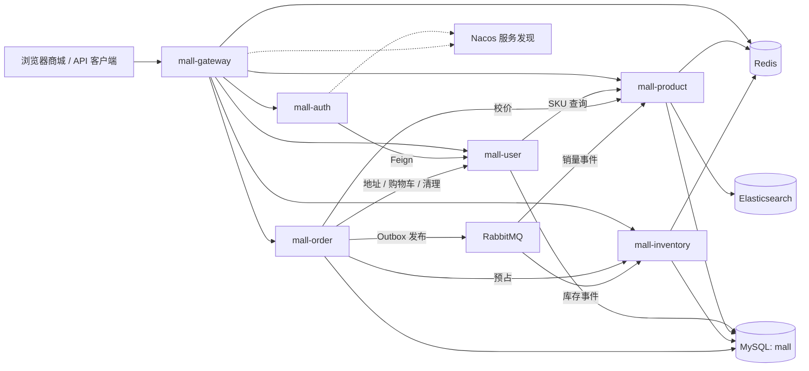

# NovaMall

基于 Spring Cloud Alibaba 的商城后端项目，围绕商品、SKU、购物车、订单和库存构建交易流程，实践服务端校价、订单快照、库存预占、消息 Outbox 和请求幂等。

项目定位为个人商城作品，当前处于前后端演示闭环完善阶段：已有核心交易逻辑、轻量商城页面和自动化测试，正在补齐真实环境联调。支付、发货和收货保留 Mock，后续优先完善使用体验，并逐步接入电商客服 Agent。详细设计过程见 [后端改造记录](BACKEND_PROGRESS.md)。

## 目录

- [技术栈](#技术栈)
- [架构与模块](#架构与模块)
- [功能状态](#功能状态)
- [核心设计](#核心设计)
- [本地启动](#本地启动)
- [模拟购买演示](#模拟购买演示)
- [浏览器商城](#浏览器商城)
- [接口与请求示例](#接口与请求示例)
- [测试与验证](#测试与验证)
- [监控与接口文档](#监控与接口文档)
- [已知限制与路线图](#已知限制与路线图)

## 技术栈

| 技术 | 当前版本 / 用途 |
| --- | --- |
| Java / Maven | 源码和字节码目标 17，本地使用 OpenJDK 25；Maven 3.9+ |
| Spring Boot | 3.3.6 |
| Spring Cloud / Alibaba | 2023.0.3 / 2023.0.3.2 |
| Gateway / OpenFeign / Nacos | API 网关、服务间调用、服务注册与发现；Nacos 2.4.3 |
| MyBatis-Plus / MySQL | 3.5.7 / 8.4，业务持久化、条件更新和事务 |
| Redis | 7.4，商品缓存、排行榜、网关限流、秒杀 Lua 脚本 |
| RabbitMQ | 4.0，订单事件与秒杀消息 |
| Elasticsearch | 8.15.0，商品搜索 |
| JWT / BCrypt | 登录令牌和密码哈希 |
| JUnit 5 / Mockito / MockMvc | 单元测试、入参校验和接口契约测试 |
| Actuator / Micrometer / Prometheus / Grafana | 健康检查、指标采集和展示 |

Compose 同时提供 MinIO 开发实例，商品图片上传业务尚未接入。

## 架构与模块



图中展示主要业务依赖，Nacos 用于各服务的注册与发现。服务按领域拆分，目前共用一个 MySQL 数据库；跨领域业务查询主要通过 Feign 调用。

| 模块 | 端口 | 职责 |
| --- | --- | --- |
| `mall-gateway` | 8080 | 路由、JWT 验证、部分路由限流、Trace ID、商城静态页面 |
| `mall-auth` | 8081 | 登录和令牌签发 |
| `mall-user` | 8082 | 注册、收货地址、购物车 |
| `mall-product` | 8083 | 分类、商品、SKU 查询、搜索和排行榜 |
| `mall-inventory` | 8084 | 库存预占、释放、确认及秒杀实验流程 |
| `mall-order` | 8085 | 下单、购物车结算、订单状态、Outbox 与清理任务 |
| `mall-common` | - | 通用响应、Web、认证工具、ID、Redis、消息等公共模块 |

```text
NovaMall/
├── mall-common/          公共模块
├── mall-gateway/         API 网关
├── mall-auth/            认证服务
├── mall-user/            用户服务
├── mall-product/         商品服务
├── mall-inventory/       库存服务
├── mall-order/           订单服务
├── database/init/       初始化与升级 SQL
├── scripts/             PowerShell 联调脚本
├── monitoring/          Prometheus / Grafana 配置
├── .github/workflows/   CI 配置
├── docker-compose.yml   本地基础设施
└── BACKEND_PROGRESS.md  设计演进与验证记录
```

## 功能状态

“已实现”表示存在业务代码；实际数据库和跨服务验证范围见[测试与验证](#测试与验证)。

| 领域 | 已实现 | 待完善 |
| --- | --- | --- |
| 用户与认证 | 注册、BCrypt 密码哈希、JWT 登录、网关注入用户身份、管理写接口 ADMIN 校验 | 用户资料管理、角色管理界面、内部服务认证 |
| 地址 | 新增、列表、删除、下单时校验归属并保存快照 | 编辑、默认地址切换及并发唯一性 |
| 商品 | 分类/商品 CRUD、上下架、默认 SKU、已有多 SKU 查询 | 多规格管理、图片管理、描述/主图/划线价写入接口 |
| 搜索与排行 | Elasticsearch 搜索、异常时 MySQL 回退、Redis 热度/销量排行 | 索引可靠同步、销量去重和计数原子性 |
| 购物车 | SKU 引用、增删改、单项勾选、版本化更新、选中项结算 | 实时价格/库存汇总、全选 |
| 库存 | SKU 预占、释放、确认、条件更新与版本检查 | 持久化故障补偿、对账、SKU 并发集成验证 |
| 订单 | 创建、分页、取消、超时取消、商品/地址快照、完整详情、金额明细、操作列表、持久化状态历史 | 详情页面、在线联调 |
| 支付与物流 | Mock 支付/发货/收货，支付和物流记录写入、收货更新物流状态 | 退款和售后演示；真实支付与物流暂缓 |
| 工程支持 | Trace ID、Outbox 发布重试、Actuator、CI、联调脚本 | 完整集成测试、故障演练、生产部署配置 |
| 浏览器商城 | 登录/注册、商品搜索与详情、SKU 选择、购物车、地址、结算、订单详情、Mock 操作 | 浏览器与真实服务联调、商品图片上传和后台体验完善 |
| 商品管理 | ADMIN 商品列表、新增/编辑、分类创建、上下架、按 SKU 补库；分类/销量/库存展示 | 多规格价格编辑、图片与完整描述管理 |

## 核心设计

### SKU 校价与订单快照

下单只接受商品引用和数量。服务端从商品服务读取当前 SKU 信息，校验上架状态与价格，再合并数量并预占库存：

- 同一 SKU 的重复行合并；同商品不同 SKU 独立计价和预占。
- 旧 `productId` 下单请求解析为该商品的默认 SKU，每项只能提交 `productId` 或 `skuId` 之一。
- 订单项保存商品名称、主图、规格、成交价快照，历史订单不依赖商品当前信息。
- 金额计算使用 `BigDecimal`；订单地址复制下单时的收货信息。
- 下单校价走数据库 SKU 查询，不使用商品浏览缓存。

### 库存与订单事件

库存通过数量条件和版本号更新，预占记录按订单与 SKU 标识。支付事件确认库存，取消事件释放库存。

订单变更与 Outbox 记录在同一个本地事务中写入；发布器使用 RabbitMQ publisher confirm、路由返回检查和退避重试。该机制不等同于跨服务事务：进程崩溃、远程超时后延迟提交或释放失败，仍需后续补偿与对账覆盖。

订单创建、支付、发货、收货、主动取消和超时取消会在同一事务中写入 `mall_order_history`。Mock 支付同时写入 `mall_payment`，Mock 发货写入 `mall_shipment`，收货将模拟物流状态更新为 `DELIVERED`。记录写入失败会回滚该次订单变更和 Outbox 写入。主动取消和超时取消分别保存 `USER_CANCELLED` / `PAYMENT_TIMEOUT` 原因，超时更新还会在 SQL 中检查订单确实已过期。

### 购物车结算与重试

`POST /api/orders/checkout` 从用户服务读取当前选中项，通过用户 ID 与 UUID `requestKey` 识别一次结算意图。

- 相同用户、相同键的成功请求重试返回原订单；同键换地址会被拒绝。
- 订单、结算记录、购物车清理任务在同一个本地事务中保存。
- 后台任务在提交后调用用户服务清理购物车，失败后退避重试。
- 清理要求购物车项的原版本匹配；结算期间被修改的行会保留。

前端应为一次结算生成一个键，并在所有重试中保留它。不同键表示不同请求；旧的直接下单接口尚未提供同等请求去重能力。

## 本地启动

### 1. 准备环境

- IntelliJ IDEA，推荐使用已验证的 OpenJDK 25。
- Maven 3.9+。
- Docker Desktop / Docker Engine 和 Compose v2。
- PowerShell，用于执行仓库中的联调脚本。

```powershell
git clone https://github.com/Bryce-border/NovaMall.git
cd NovaMall
java -version
mvn -version
```

IntelliJ 中打开根 `pom.xml`，将 Project SDK 和 Maven Runner JRE 设置为 OpenJDK 25。终端运行 Maven 时也需确认 `JAVA_HOME` 指向所选 JDK。POM 的源码和字节码目标目前仍为 Java 17。

### 2. 启动基础设施

```powershell
docker compose up -d
docker compose ps
```

Compose 仅启动基础设施，Java 服务需要另行启动。

| 组件 | 本地入口 |
| --- | --- |
| MySQL | `localhost:3307`，库名 `mall`；容器内端口为 3306 |
| Redis | `localhost:6379` |
| Nacos | [localhost:8848/nacos](http://localhost:8848/nacos) |
| RabbitMQ | AMQP `localhost:5672`；[管理界面](http://localhost:15672) |
| Elasticsearch | [localhost:9200](http://localhost:9200) |
| MinIO | API `localhost:9000`；[控制台](http://localhost:9001) |
| Prometheus | [localhost:9090](http://localhost:9090) |
| Grafana | [localhost:3000](http://localhost:3000) |

默认开发配置为 MySQL `root/root`、RabbitMQ `novamall/novamall`、MinIO `novamall/novamall123`。这些配置用于本地开发；管理权限由网关检查，下游服务和基础设施端口应保持本机访问。

### 3. 初始化或升级数据库

新 MySQL 数据卷会按文件名顺序执行 [database/init](database/init) 中的 SQL。已有数据卷不会因重启 Compose 自动升级。

| 脚本 | 用途 |
| --- | --- |
| `001` 至 `004` | 用户、商品、库存、订单基础表 |
| [005-order-outbox.sql](database/init/005-order-outbox.sql) | 订单消息 Outbox |
| [006-seckill.sql](database/init/006-seckill.sql) | 秒杀记录 |
| [007-mall-model-upgrade.sql](database/init/007-mall-model-upgrade.sql) | 模型扩展、默认 SKU 回填和历史库存迁移 |
| [008-cart-checkout.sql](database/init/008-cart-checkout.sql) | 购物车版本、结算请求和清理任务 |
| [009-order-history.sql](database/init/009-order-history.sql) | 订单状态历史；支付和物流复用 007 中的表 |

已有开发库应先备份、停止业务写入，确认基础脚本已执行，再依次执行 007、008、009。已执行 007、008 的库只需补 009。可在 IntelliJ Database 或 MySQL 客户端连接 `mall` 库执行。升级订单服务前必须创建历史表，否则新订单和状态流转会因记录写入失败而回滚。

**007、008、009 尚未完成真实 MySQL 的首次执行、重复执行及旧数据升级验收。** MySQL DDL 可能隐式提交，应先在隔离数据库验证，不能将这些脚本视为已验证的生产迁移方案。009 不回填旧订单历史，旧订单缺失的支付、物流记录也不会自动生成。

演示前还需在 `mall` 库执行 [database/seed/dev-admin.sql](database/seed/dev-admin.sql)，创建开发管理员 `admin / AdminPass123!`。该脚本不在自动初始化目录内，需要手动执行；重复执行会重置同名账号的密码、角色和启用状态，仅用于本地演示库。普通注册账号始终为 `USER`。

使用仓库 Compose 的 MySQL 时，可在项目根目录运行：

```powershell
Get-Content -Raw ./database/seed/dev-admin.sql | docker compose exec -T mysql sh -c 'MYSQL_PWD="$MYSQL_ROOT_PASSWORD" mysql -uroot mall'
```

也可用 IntelliJ Database 或 MySQL 客户端连接 `localhost:3307/mall` 执行该 SQL。使用自建管理员时，演示脚本支持 `-AdminUsername` 和 `-AdminPassword` 参数。

### 4. 构建并启动服务

```powershell
mvn clean verify
```

该命令执行当前自动化测试并打包，不要求先启动业务服务。随后在 IntelliJ 中依次运行：

```text
MallUserApplication
MallProductApplication
MallInventoryApplication
MallAuthApplication
MallOrderApplication
MallGatewayApplication
```

默认配置适用于 Java 服务在宿主机运行、基础设施在 Compose 中运行的方式。常用配置如下：

| 环境变量 | 作用 |
| --- | --- |
| `MYSQL_HOST` / `MYSQL_PORT` | 默认 `localhost:3307`；应用容器内应使用 `mysql:3306` |
| `MYSQL_USERNAME` / `MYSQL_PASSWORD` | Java 服务数据库凭据 |
| `MYSQL_ROOT_PASSWORD` | Compose MySQL 初始化密码；修改时需同步 Java 服务配置 |
| `NACOS_ADDR` | 默认 `localhost:8848` |
| `REDIS_HOST` / `REDIS_PORT` | 默认 `localhost:6379` |
| `RABBITMQ_HOST` / `RABBITMQ_PORT` | 默认 `localhost:5672` |
| `RABBITMQ_USERNAME` / `RABBITMQ_PASSWORD` | 消息服务凭据 |
| `JWT_SECRET` | 认证服务与网关需使用相同密钥 |
| `MOCK_PAYMENT_ENABLED` | 默认 `true`；设为 `false` 关闭 Mock 支付接口 |
| `MOCK_FULFILLMENT_ENABLED` | 默认 `true`；设为 `false` 关闭 Mock 发货/收货接口 |

网关健康检查：`GET http://localhost:8080/actuator/health`。除登录、注册等放行路径外，商品列表、分类、详情、规格及销量和库存查询允许免登录浏览；购物车、地址、订单和管理写接口仍要求携带 JWT。

## 模拟购买演示

完成数据库初始化、开发管理员种子导入，并启动基础设施和六个 Java 服务后，在项目根目录运行：

```powershell
./scripts/purchase-demo.ps1
# 自定义网关或管理员时：
./scripts/purchase-demo.ps1 -GatewayUrl http://localhost:8080 -AdminUsername admin -AdminPassword 'AdminPass123!'
```

[purchase-demo.ps1](scripts/purchase-demo.ps1) 每次创建独立的演示分类、商品、SKU 库存、买家和收货地址，再执行加入购物车、结算、模拟支付、模拟发货、确认收货和订单查询。金额由后端计算，两件单价 99.90 的商品合计 199.80；不调用真实支付或物流服务。

预期订单状态为 `PENDING_PAYMENT → PAID → SHIPPED → COMPLETED`。脚本最多等待 20 秒查看支付事件处理后的 SKU 库存，初始 10 件、购买 2 件，最终可用库存为 8、锁定库存为 0。若库存未完成异步更新，会输出警告和实际值。

最后展示订单详情中的状态时间线、模拟支付单和模拟物流单。新建并正常完成的订单应有 4 条状态历史、1 条 `SUCCESS` 支付记录和 1 条 `DELIVERED` 物流记录；已完成订单的 `actions` 为空。

保留 `MOCK_PAYMENT_ENABLED=true` 和 `MOCK_FULFILLMENT_ENABLED=true`。当前 Mock 发货接口供买家模拟自己订单的发货，尚无独立商家履约后台。脚本保留演示数据，失败后也不会删除已创建记录；重复运行会创建新一批数据。

常见阻塞：管理员登录失败时检查种子 SQL 和账号；管理操作返回 403 时确认账号为 `ADMIN` 并重新登录；返回 503 时检查对应服务是否注册到 Nacos；Mock 接口不可用时检查开关；库存迟迟未更新时检查 RabbitMQ、订单 Outbox 和库存服务日志。

## 浏览器商城

页面由网关直接托管，源码位于 [mall-gateway/src/main/resources/static/shop](mall-gateway/src/main/resources/static/shop)，使用 HTML、CSS 和原生 JavaScript，无需安装 Node 依赖或启动单独的前端服务。

1. 按前文完成数据库 001–010、管理员种子初始化，启动基础设施及六个 Java 服务；已有服务需使用最新构建，特别是网关和订单服务。
2. 推荐执行 `node scripts/replace-demo-catalog.mjs` 导入 24 件中文商品（Node.js 20+，本地 Docker MySQL 容器及服务需在线）。默认仅新增或更新清单中的同名商品；需要移除其他旧商品时，使用下文的 `--replace-existing`。旧脚本 `seed-demo-catalog.ps1` 仍保留，供独立接口演示使用。
3. 打开 [http://localhost:8080/shop/index.html](http://localhost:8080/shop/index.html)，注册普通买家并登录。商品可免登录浏览；使用购物车、地址和订单前需登录。
4. 进入商品详情选择 SKU，加入购物车；新增收货地址、勾选商品并提交订单。购物车金额为当前商品参考价格，订单金额由后端重新结算。
5. 在订单详情执行模拟支付、发货和收货，查看状态时间线、支付单与物流单；也可取消未支付订单。

业务 API 请求使用页面所在网关的 `/api`，不配置跨域访问，也不直接调用内部服务。页面支持窄屏布局、订单分页/状态筛选、错误提示、登录失效处理和破损图片回退。页面采用中文电商布局：顶部搜索、分类导购、精选商品、会员入口及价格优先的商品卡片，不显示品牌 Logo。分类筛选与搜索读取实际商品数据；列表、详情与管理员表格有图片 URL 时显示商品图片；无图或图片加载失败时回退到标注“商品示意图”的插画；无商品时展示空状态，不伪造购买数据。

浏览器用当前标签页的 `sessionStorage` 保存令牌，不保存密码。兼容旧接口返回的长整数 ID，在 JSON 解析前保留其精度。一次结算的请求键会保存到当前标签页：超时或服务端错误后保留原键，重试查回原订单；结果确认前暂停修改购物车，成功后等待已购买条目完成异步清理。页面关闭后会失去该标签页的请求状态，不提供跨设备或多个独立标签页之间的结算去重保证。

服务尚未启动时页面中的业务请求不能完成；商品初始化脚本也需要服务在线。当前已完成静态页面与接口接入，尚未完成浏览器和真实数据库的整套在线验收。

### 管理员入口与数码商品示例

打开 `/shop/index.html#admin`，使用开发管理员 `admin / AdminPass123!` 登录；登录后导航栏会出现“商品管理”。前端角色识别仅控制入口展示，管理写操作仍由网关验证管理员 JWT。

页面底部始终显示“管理员入口”。使用买家账号访问时，可点击“切换管理员账号”退出并打开登录窗口。

### 一条命令启动与停止

数据库初始化完成后，可在项目根目录执行：

```powershell
# 初次运行或改动代码后：构建（跳过测试），启动依赖和六个 Java 服务
./scripts/start-local.ps1 -Build
# 平时启动，复用已运行的本项目服务
./scripts/start-local.ps1
# 修改代码后重新构建并重启本项目服务
./scripts/start-local.ps1 -Build -Restart
# 仅停止本项目 Java 服务
./scripts/stop-local.ps1
# 同时停止 Compose 基础设施，保留数据卷
./scripts/stop-local.ps1 -Infrastructure
```

启动脚本默认网关端口为 **18080**，启动成功后访问 [管理员端](http://127.0.0.1:18080/shop/index.html#admin) 或 [商城](http://127.0.0.1:18080/shop/index.html)。可用 `-GatewayPort` 修改端口；需调整已运行网关时加 `-Restart`。脚本检查端口占用，不会关闭其他项目的程序。

需要 Docker Desktop 和 JDK 17+；优先使用 `JAVA_HOME`，也支持 `-JavaExecutable 'C:\path\to\jdk\bin\java.exe'`。Windows 后台进程使用项目 `logs/java-tmp` 作为临时目录，避免此前系统 TEMP 短路径引发的 Java 回环连接失败。日志位于 `logs/<服务名>-runtime.out.log` 和 `.err.log`，启动脚本等待健康检查，并检查页面标题是否为 NovaMall。

脚本只启动 MySQL、Redis、Nacos、RabbitMQ、Elasticsearch 五个必要基础设施；可传 `-SkipInfrastructure` 使用已启动的依赖。它不会对已有数据库执行迁移、重置管理员或创建商品，数据库升级仍按前文执行；启动失败时查看日志，修正后再次运行，或用停止脚本关闭已启动的服务。

管理员可新增/编辑商品名称、分类、价格、简介、HTTPS 商品图片地址、商品介绍和上架状态，创建分类，并为指定 SKU 增加库存。新增商品先保存，再补库存；补库数量为增量。商品价格编辑同步到默认 SKU，现有其他规格的价格暂不在此页面编辑。列表支持搜索、状态筛选和分页。

商城卡片和管理列表展示商品分类、价格、已售量、可用库存；管理员还能看到预占库存。销量使用 Redis 中已完成订单累计的购买件数，并非成交订单笔数，也不使用排行榜前 N 名来推断零销量。数据异步更新，Redis 历史丢失或旧订单未计入时不等于完整历史销量；这是当前演示统计口径。库存汇总只统计 SKU 库存，查询失败显示不可用，不填零。

数码商品示例（默认网关 18080，其他端口可传 `-GatewayUrl`）：

```powershell
./scripts/seed-digital-demo.ps1
```

脚本创建“手机数码产品”分类和 `iPhone 17 Pro` 商品，演示售价 10000 元、初始库存 100 件；不伪造已售量，销量随后由完成订单累计。重复执行保留已有同分类同名商品，不重置售价或库存。这里的价格仅用于项目演示。

当前本地启动使用 `http://127.0.0.1:18080/shop/index.html`，POM/配置默认端口仍为 8080。

### 中文商品目录与网络图片

[demo-catalog.json](database/seed/demo-catalog.json) 保存 24 件商品、7 个分类，包括手机数码产品、电脑平板、耳机音响、家居生活、厨房用品、运动户外和个护美妆。名称与图片参考 DummyJSON 公开演示商品库；iPhone 17 Pro 使用 Wikimedia Commons 上 Olgierd Rudak 提供的 CC0 照片。完整来源记录在清单、商品介绍和页面底部“商品图片来源”中，图片采用外链。

```powershell
# 导入 / 更新清单中的商品，其他商品保留
node scripts/replace-demo-catalog.mjs
# 用该清单替换当前目录，软删除清单以外的商品及闲置分类
node scripts/replace-demo-catalog.mjs --replace-existing
```

脚本仅允许本机网关，默认 `http://127.0.0.1:18080`，可用 `NOVAMALL_GATEWAY`、`NOVAMALL_ADMIN_USERNAME`、`NOVAMALL_ADMIN_PASSWORD` 环境变量配置。需先构建并重启最新商品服务与网关以支持图片字段。每次执行前备份商品、规格、分类、库存表及目录快照到被 Git 忽略的 `logs/catalog-backup-*/`，备份失败则停止；所有新商品准备完成后才清理旧目录。操作日志与结果也保存在该目录。

价格和初始库存是本项目演示设置，不是外部平台实时报价；销量只由本项目完成订单累计。重复执行会按清单更新名称对应商品的展示信息和价格，仅在库存行不存在时初始化库存，不重置既有库存或销量。旧商品采用软删除，历史订单及其商品快照保留。后台商品写接口支持可选 `coverImageUrl`、`description`：省略字段保留已有内容，空字符串清空；默认规格同步图片，商品列表返回 `coverImageUrl`。

2026-10-10 本地替换结果：移除 31 件旧商品、18 个旧分类，保留并完善 iPhone 17 Pro，最终 24 件商品 / 7 个分类。全部图片链接返回图片内容；目录、销量和库存读取核验通过，订单及订单明细数量未变化。商品与规格相关 10 项单元测试通过。浏览器自动化因环境初始化错误未能完成视觉检查。

## 券券宝与商城交互

已支持限时领券、19.9 元五张券包、个人优惠券、服务端结算抵扣、悬浮购物车、自动加载商品及管理员弹窗。已有数据库需执行新增迁移 010 并重启订单服务和网关。初始化活动、使用规则、API 和验证方式见 [券券宝与商城交互](docs/COUPONS_AND_STOREFRONT.md)。

## 接口与请求示例

接口统一从 `http://localhost:8080` 访问。登录后使用：

```http
Authorization: Bearer <accessToken>
```

| 领域 | 主要接口 |
| --- | --- |
| 注册 / 登录 | `POST /api/users/register`、`POST /api/auth/login` |
| 商品 | `GET /api/products`、`GET /api/products/{id}/detail` |
| SKU | `GET /api/products/{productId}/skus` |
| 搜索 / 排行 | `GET /api/products/search`、`GET /api/products/hot`、`GET /api/products/sales` |
| 展示统计 | `GET /api/products/sales-counts?productIds=…`、`GET /api/inventory/summary?productIds=…`，逗号分隔，最多 100 个商品 ID |
| 地址 | `GET /api/users/addresses`、`POST /api/users/addresses`、`DELETE /api/users/addresses/{id}` |
| 购物车 | `GET /api/users/cart`、`POST /api/users/cart/items` |
| 修改 / 删除购物车项 | `PUT /api/users/cart/items/{id}`、`DELETE /api/users/cart/items/{id}` |
| 勾选购物车项 | `PUT /api/users/cart/items/{id}/selected?selected=true` |
| 库存 | `POST /api/inventory`、`GET /api/inventory/skus/{skuId}` |
| 下单 / 结算 | `POST /api/orders`、`POST /api/orders/checkout` |
| 订单查询 | `GET /api/orders?page=1&size=10&status=PAID`、`GET /api/orders/{orderNo}` |
| 完整订单详情 | `GET /api/orders/{orderNo}/detail`：金额、地址和商品快照、支付、物流、状态历史和可执行操作 |
| 状态流转 | `POST /api/orders/{orderNo}/cancel`、`/pay`、`/ship`、`/complete` |
| 秒杀实验 | `POST /api/seckill/{productId}/prepare`、`POST /api/seckill/{productId}`、`GET /api/seckill/orders/{seckillNo}` |

通过网关访问时，商品和分类的新增、修改、删除，补充库存以及秒杀准备接口要求 JWT 中的角色为 `ADMIN`，其他已登录用户访问这些接口返回 403。网关覆盖客户端传入的 `X-User-Id`、`X-User-Name` 和 `X-User-Role`，再向业务服务传递签名令牌中的身份。`/internal/**` 用于服务间调用，未配置网关路由；直接访问下游端口仍会绕开网关权限检查，因此演示客户端统一使用 8080。

以下 ID 均为示例，需替换为实际接口返回值。

补充 SKU 库存时提交商品和 SKU 两个 ID；SKU 下单不会回退到未迁移的商品级库存：

```json
{
  "productId": "10001",
  "skuId": "11001",
  "quantity": 10
}
```

加入购物车，`POST /api/users/cart/items`：

```json
{
  "skuId": "11001",
  "quantity": 2
}
```

购物车结算，`POST /api/orders/checkout`：

```json
{
  "requestKey": "e8b6a56a-d2bc-40a5-89b4-89ac1648a900",
  "addressId": "80001"
}
```

直接下单，`POST /api/orders`：

```json
{
  "items": [
    { "skuId": "11001", "quantity": 2 }
  ],
  "addressId": "80001"
}
```

购物车结算要求地址；直接下单目前仍兼容不传地址的旧请求。两种路径均由后端计算金额。

通用成功响应：

```json
{
  "success": true,
  "code": "0",
  "data": {},
  "message": "OK",
  "traceId": "8f2e7a1234567890abcdef1234567890ab"
}
```

SKU 和新订单详情响应使用字符串 ID 和金额，其余接口尚未全部统一；订单时间仍使用无时区的 `LocalDateTime`。详情接口先校验当前用户的订单归属，再查询地址、支付和物流信息；完整字段和操作规则见 [订单详情接口](docs/ORDER_DETAIL_API.md)。

## 测试与验证

2026-10-01 权限、订单详情、模拟交易记录与浏览器商城更新：执行 `mvn -s .mvn-local-settings.xml -DskipTests package`，15 个 reactor 项目编译打包成功；前端 JavaScript、购买演示和商品初始化脚本语法检查通过。本轮未执行功能测试、数据库迁移、种子导入或浏览器在线购买联调，以下测试数量为历史记录。

2026-09-10 本地验证记录：OpenJDK 25 下根项目 Maven `verify` 通过，15 个 reactor 项目构建成功，**69 项测试通过，失败、错误、跳过均为 0**。

| 测试范围 | 数量 |
| --- | ---: |
| 订单、购物车结算、清理重试和 MVC 契约 | 28 |
| 用户购物车 | 7 |
| 商品、SKU、缓存及搜索回退 | 8 |
| 库存与秒杀 | 21 |
| Trace ID、JWT 和 ID 工具 | 5 |

```powershell
mvn test
mvn clean verify
```

当前测试主要使用 Mockito、MockMvc 和 Jackson，不能代替真实 SQL、事务回滚、跨服务网络调用、消息恢复和并发压测。仓库尚无可引用的 QPS/TPS 或高并发性能结论。

[GitHub Actions](.github/workflows/ci.yml) 配置了 JDK 17 / 25 矩阵，在推送到 `main/master` 或向其提交 PR 时运行 `clean verify`；远程结果以 Actions 实际运行记录为准。

基础设施、数据库和 Java 服务就绪并导入开发管理员后，可执行以下脚本。通过网关创建商品、分类、库存和秒杀准备数据的脚本统一使用管理员登录，购买和查询仍使用各自注册的普通用户。脚本会创建开发测试数据，应在隔离开发环境运行。

| 脚本 | 验证目标 |
| --- | --- |
| [smoke-test.ps1](scripts/smoke-test.ps1) | 注册、登录、商品、下单、取消与库存释放 |
| [cart-checkout-test.ps1](scripts/cart-checkout-test.ps1) | 最新价格结算、请求重试、购物车清理、历史快照与取消 |
| [payment-test.ps1](scripts/payment-test.ps1) | Mock 支付和重复支付拒绝 |
| [order-lifecycle-test.ps1](scripts/order-lifecycle-test.ps1) | 支付、发货、收货状态流转 |
| [inventory-concurrency-test.ps1](scripts/inventory-concurrency-test.ps1) | 商品级库存并发预占检查；不替代 SKU 并发测试 |
| [seckill-test.ps1](scripts/seckill-test.ps1) | Redis Lua 与消息秒杀流程 |
| [search-test.ps1](scripts/search-test.ps1) | 商品搜索 |
| [ranking-test.ps1](scripts/ranking-test.ps1) / [sales-ranking-test.ps1](scripts/sales-ranking-test.ps1) | 热度与销量排行 |
| [rate-limit-test.ps1](scripts/rate-limit-test.ps1) | 网关限流 |
| [trace-id-test.ps1](scripts/trace-id-test.ps1) | Trace ID 生成与传播 |
| [openapi-test.ps1](scripts/openapi-test.ps1) | OpenAPI 文档可访问性 |

上述八个需要管理数据准备的网关联调脚本均支持 `-AdminUsername` / `-AdminPassword`。`inventory-concurrency-test.ps1` 是直接访问 8084 和内部接口的独立库存实验，不经过网关，也不属于购买演示。

```powershell
./scripts/smoke-test.ps1
./scripts/cart-checkout-test.ps1
```

最新 SKU/结算改造尚未完成上述脚本的整套在线回归；新增结算脚本已通过 PowerShell 语法检查，尚未完成实际跨服务执行。

## 监控与接口文档

- 服务通过 `/actuator/health` 提供健康检查，通过 `/actuator/prometheus` 暴露指标。
- [monitoring](monitoring) 包含 Prometheus 和 Grafana 配置；Prometheus 通过 `host.docker.internal` 采集宿主机上的六个应用。Linux Docker 环境需确保该主机名可解析。
- 网关和 Servlet 服务支持 `X-Trace-Id`；认证、用户、订单的同步 Feign 调用传播该标识，服务日志通过 MDC 输出。
- 各服务 Swagger UI：`http://localhost:<服务端口>/swagger-ui.html`；原始文档为 `/v3/api-docs`。业务接口请查看对应服务文档，网关文档不代表已聚合全部服务接口。

## 已知限制与路线图

按个人作品的投入产出顺序推进：

- [x] 网关区分普通用户与管理写操作，提供开发管理员初始化和模拟购买脚本。
- [ ] 在真实本地 MySQL 上完成初始化、旧库升级和重复执行验证，再跑通完整购买演示。
- [x] 补齐订单详情：地址快照、状态历史、Mock 支付/发货记录和可执行操作，便于页面与客服引用（在线联调待完成）。
- [ ] 统一对外 ID、金额、时间、分页和错误响应；补地址编辑、购物车实时价格/库存汇总。
- [x] 做一个轻量前端，串起商品、购物车、地址、结算、订单详情和模拟状态操作（在线联调待完成）。
- [ ] 补 SKU、图片和商品描述管理，以及客服入口。
- [ ] 客服 Agent 第一版：商品和规则问答、当前用户订单查询，明确标注 Mock 支付/物流数据；通过有用户身份校验的业务 API 查询，不直接访问数据库，也不持有管理员令牌。
- [ ] 客服 Agent 第二版：在只读问答稳定后加入取消未支付订单等操作，执行前展示订单和影响并让用户确认；为关键问答和工具操作积累回归案例。

暂时保留单实例、本地共用 MySQL 和 Mock 购买链路。内部接口认证、库存故障补偿、搜索索引可靠同步和销量去重仍有缺口；当前固定 worker ID 也不适合直接多实例扩容。这些是现阶段边界，近期优先把演示、数据展示和客服查询所需的业务接口做好。
