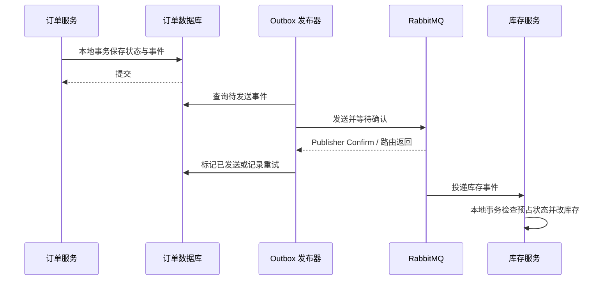

# NovaMall 项目面试讲解手册

对应 [简历项目经历](RESUME_PROJECT.md)，依据 2026-09-11 代码。下面的口述稿是讲解模板，请结合本人实际参与过程使用；“下一步方案”不代表已经实现。

简历现有两个版本：推荐版突出 Redis/RabbitMQ，交易主线版突出订单一致性。推荐版第 1、2 条重点阅读第 11 节，第 3 条对应第 5 节，第 4 条对应第 2、3 节，第 5、6 条对应第 4、6 节。

## 1. 先用一分钟介绍项目

> NovaMall 是一个商城后端实践项目，按用户、商品、库存、订单等领域拆分服务。我重点关注的是下单过程中价格、库存、订单和购物车之间怎么保持合理的一致性。
>
> 下单时，服务端把商品引用统一成 SKU，读取价格并保存快照；库存通过 MySQL 条件更新进行预占。购物车结算使用用户和请求键识别重试，成功后复用原订单。订单与 Outbox 事件一起提交，由 RabbitMQ 衔接库存确认和释放；购物车清理单独使用持久化任务，并按版本删除，避免删掉用户后续修改。
>
> 目前已有 69 项单元和 MVC 等测试在 JDK 25 下通过。支付和履约仍是 Mock，数据库并发、迁移和进程崩溃恢复还需要集成验证。

这里选择的是“业务问题 -> 设计机制 -> 验证范围”的顺序。不要开场逐个介绍中间件，也不要把演示项目描述成线上商业系统。

## 2. 交易主线版第一条：SKU 建模与交易快照

### 问题、原理与选择原因

一个商品可能有黑色、白色和不同容量。SPU 表示商品集合，SKU 表示可以独立定价和管理库存的销售规格。如果只按 productId 合并订单，同商品的两种规格会混成一项。

当前处理过程：

1. 请求每项只接受 productId 或 skuId 中的一个，以及正数数量。
2. 旧 productId 请求解析为明确的默认 SKU，不是任意挑选一个在售规格。
3. 商品服务查询数据库中的 SKU 和所属商品，检查是否可售，返回价格和规格。
4. 订单服务统一以 skuId 合并数量，检查数量溢出、金额精度和整单金额上限。
5. 按 SKU 预占库存；保存名称、图片、规格、价格与收货地址快照。

“当前可购买信息”和“历史成交信息”属于不同业务事实。历史订单冗余保存快照是有意的，不应在展示时重新查询当前商品名和价格。

例如：下单时黑色款 99.90 元，数量 2；之后改名并涨到 109.90 元。历史订单仍应是原名称、单价 99.90、金额 199.80。当前已经保存这些快照，但订单详情 DTO 尚未完整返回地址和规格等所有字段。

### 其他方法与取舍

| 方案 | 好处 | 问题 / 适用条件 |
| --- | --- | --- |
| 前端传价格 | 请求简单 | 可被篡改，也可能过期，不可作为成交价依据 |
| 使用浏览缓存校价 | 减少数据库访问 | 可能用旧价成交，需要价格版本、失效策略等额外约束 |
| 当前数据库 SKU 查询 | 与商品维护数据来源一致，容易解释和验证 | 增加服务调用；不能锁住之后的价格变动 |
| 订单只存商品外键 | 数据少 | 改名、下架、删图会影响历史展示 |
| 订单存快照 | 历史交易独立于当前目录 | 占用额外空间；保存图片 URL 不保证图片文件永久存在 |
| 商品版本表 + 订单引用版本 | 历史数据可共享、可追溯 | 要设计版本生成、保留和关联规则，复杂度更高 |

**为什么使用 BigDecimal？** 二进制浮点不能精确表示许多十进制小数。金额应来自十进制字符串或数据库 DECIMAL，避免 `new BigDecimal(0.1)`；单价乘整数数量可精确计算。后续出现折扣、税费、分摊时，还要明确舍入规则，不能认为用了 BigDecimal 就自动解决财务规则。

**为什么接口 ID 要字符串？** 雪花 ID 的 Long 可能超过 JavaScript 的安全整数上限 2^53-1。字符串可避免 JSON 被浏览器解析成 Number 后失真。当前只在部分 DTO 实现，不要回答“所有接口都统一了”。

### 面试口述

> 我先把商品和可销售规格分开，库存与订单数量都按 SKU 处理。商品服务负责给出当前可售状态和价格，订单服务负责计算并复制快照。这样不会把两种规格合并，也不会让历史订单随着商品目录变化。代价是订单中有冗余数据和额外校价调用，但它们服务的是历史交易这个独立事实。

### 继续追问

- **查询完价格后立刻涨价怎么办？** 当前语义是采用校价时读到的价格，不保证订单提交瞬间的全局最新价。严格报价场景可引入带有效期的报价单或 SKU 价格版本，并在确认阶段校验。
- **前端显示 99 元，实际结算变成 109 元呢？** 后端现在直接按当前价格算单；完整产品体验需要结算预览和价格变化确认，尚未实现。
- **既然先查库存，为何仍要 SQL 条件？** 查询只能作预检查，读完到更新前库存仍可能变化，最终判断必须在原子更新中执行。
- **默认 SKU 是完整多规格管理吗？** 不是。已有多 SKU 可以查询和下单，但后台创建、编辑任意规格的接口仍待补齐。

代码：[SKU 服务](../mall-product/src/main/java/cn/novamall/product/service/SkuApplicationService.java) 的 `get/defaultForProduct`；[订单服务](../mall-order/src/main/java/cn/novamall/order/service/OrderApplicationService.java) 的 `resolveItems/loadAddress/create`。

证据：[订单测试](../mall-order/src/test/java/cn/novamall/order/service/OrderApplicationServiceTest.java) 中 `explicitSkusOfSameProductKeepSeparatePricesAndSnapshots`、`mixedLegacyAndSkuReferencesMergeBeforeReservation`、`ownedAddressIsCopiedIntoOrderSnapshot`。

## 3. 交易主线版第二条：库存预占与状态约束

### 为什么需要预占

付款前立即永久扣减库存，取消后需要恢复；付款后才扣库存，又可能让大量待付款订单竞争同一库存。当前采用可用库存转锁定库存，给待付款订单保留购买份额。

本项目库存字段的含义是：total_stock 表示当前未售出实物总量，包括可用和已预占部分，不是历史累计入库量。正常操作下满足 `total = available + locked`。

| 操作 | total | available | locked |
| --- | ---: | ---: | ---: |
| 初始库存 | 10 | 10 | 0 |
| 预占 2 件 | 10 | 8 | 2 |
| 取消这笔预占 | 10 | 10 | 0 |
| 若从预占状态确认支付 | 8 | 8 | 0 |

### SQL 如何约束并发

核心更新的等价形式如下，参数使用 MyBatis 占位符：

```sql
UPDATE mall_inventory
SET available_stock = available_stock - #{quantity},
    locked_stock = locked_stock + #{quantity},
    version = version + 1
WHERE sku_id = #{skuId}
  AND version = #{version}
  AND available_stock >= #{quantity};
```

两个请求都读到版本 3、可用库存 1。第一个更新成功后版本变成 4，可用库存变成 0；第二个不能再用版本 3 更新成功。受影响行数为 1 才算成功，0 表示库存不足或版本冲突等情况。

这里有两个不同的条件：`available_stock >= quantity` 直接防止库存扣成负数；`version = oldVersion` 检测读后数据是否改变。单纯增减计数时，仅带数量条件的原子 UPDATE 也能防止负库存，版本不是不可替代的必需条件。

预占记录与库存更新在库存服务的同一本地事务中完成。预占记录用订单与 SKU 唯一约束查重，重复请求还检查数量是否一致。释放和确认使用 `LOCKED -> RELEASED/CONFIRMED` 条件迁移，只有迁移成功才改库存，避免重复事件重复增减。

**乐观锁不等于数据库没有锁。** InnoDB 执行 UPDATE 仍会使用行锁；“乐观”指应用层通过版本冲突判断是否可更新，而不是先显式锁住再读。

### 替代方案

| 方案 | 适合什么 | 相比当前方案的取舍 |
| --- | --- | --- |
| synchronized | 单 JVM 临界区 | 不能协调多个服务实例 |
| 仅库存条件 UPDATE | 简单原子计数 | 少一层版本冲突，对热点计数可能更合适 |
| SELECT FOR UPDATE 后更新 | 需要在锁内检查多项规则 | 容易推理，但持锁时间和等待增加 |
| 版本检查 + 库存条件 | 需要识别旧读和限制库存 | 冲突多时重试成本高，不必然更快 |
| Redis Lua 预扣 | 秒杀资格预筛选和高频准入 | Redis 与 MySQL 之间仍需落库、恢复和对账 |
| Redis / Redisson 分布式锁 | 跨实例互斥业务 | 增加租约、续期和锁失效问题，数据库条件仍需兜底 |

选择 MySQL 是因为库存最终持久化在数据库，可以把约束和数据更新放在一起。当前规模没有实测数据证明必须先引入 Redis 库存作为主路径。

### 面试口述

> 库存预占在一条 SQL 中完成“可用减、锁定加”，用库存条件阻止负数，用版本号识别并发旧读。库存和预占记录在同一事务里提交。消息重放时，预占状态迁移决定是否再次改库存。数据库约束是最终保护，Java 的查库存只是提前给出错误提示。

### 继续追问与已知边界

- **重试三次一定成功吗？** 不一定。当前在同一事务内重读；MySQL REPEATABLE READ 的快照读可能仍看到旧版本，所以循环不保证读取到其他事务刚提交的版本。需要真实并发测试，再考虑独立事务重试、当前读或去掉不必要的版本条件。这是待验证问题。
- **两个完全相同的请求同时插预占记录呢？** 唯一键让第二条记录不能成功插入，本地事务应回滚其库存变化；当前没有完整映射所有并发唯一键异常为幂等成功响应。约束正确不等于接口体验已经完善。
- **支付和取消同时到达呢？** 普通操作先锁订单行，再按预期状态条件更新；超时取消也使用条件 UPDATE。从待付款状态只能有一个转换成功。数据库状态与 Outbox 在同事务提交，不代表库存消费者同步完成。
- **大量 SKU 订单会不会死锁？** 可能。需要统一跨订单的锁定顺序、缩短事务并对可重试异常重试；当前没有完成这种并发验收。
- **30 分钟超时如何处理？** 当前定时扫描，每次最多 100 个待付款超时订单，逐个条件取消，并非精确到时触发的延迟队列。积压时会延后处理。延迟消息更适合及时触发，扫描仍可作为对账兜底。

代码：[库存 Mapper](../mall-inventory/src/main/java/cn/novamall/inventory/mapper/InventoryMapper.java)、[库存服务](../mall-inventory/src/main/java/cn/novamall/inventory/service/InventoryApplicationService.java)、[预占 Mapper](../mall-inventory/src/main/java/cn/novamall/inventory/mapper/InventoryReservationMapper.java)、[订单状态 SQL](../mall-order/src/main/java/cn/novamall/order/mapper/OrderMapper.java)。

证据：[库存测试](../mall-inventory/src/test/java/cn/novamall/inventory/service/InventoryApplicationServiceTest.java) 验证 SKU 路由、归属检查、参数冲突和释放确认行为；不证明 MySQL 行锁和真实并发效果。

## 4. 交易主线版第三条：购物车结算幂等

### 为什么前端防重复点击不够

前端按钮禁用只能减少一次页面里的重复操作。浏览器超时重试、代理重试、刷新页面、多个设备仍可能发送相同业务请求。后端必须识别“重试原请求”和“新买一单”的区别。

当前数据库唯一键为 `(user_id, request_key)`。客户端为一次意图生成 UUID，服务端先 upsert 结算行，再 `SELECT ... FOR UPDATE`，在锁内检查 addressId 与已有 orderNo。

1. 首次请求读取服务端选中购物车项，创建订单，记录 orderNo。
2. 原请求提交成功但响应丢失，重试读取已有 orderNo 并返回原订单。
3. 同键请求在原事务尚未提交时到达，唯一键相关的写锁让请求等待或失败重试，不会绕过数据库直接各自创建。
4. 已存在的键换 addressId，按冲突拒绝。
5. 本地事务回滚时结算记录一起回滚，重试可再发起一次创建；此前远程预占能否正确释放是另一个问题。

`CartOrderService` 调用另一个 Spring Bean 的 `OrderApplicationService`，默认 REQUIRED 传播使订单和结算记录加入同一个订单数据库事务。调用远端库存服务的 HTTP 请求不会自动加入该事务。

### 和其他方案有什么区别

| 方案 | 优点 | 为什么不能简单替代 |
| --- | --- | --- |
| 前端按钮防抖 | 改动小、体验好 | 不覆盖网络重试和多设备 |
| 每个用户只能有一笔订单 | 强限制 | 阻止合法复购，不符合请求语义 |
| Redis SET NX + TTL | 快、可做防重准入 | 到期、崩溃、结果存储与数据库提交之间仍有窗口 |
| 数据库唯一键 + 原订单号 | 持久化请求身份与结果，能查回原订单 | 增加存储和锁等待，需要清理策略 |
| 请求键 + 内容摘要 | 能拒绝同键不同业务参数 | 必须定义规范化内容；当前只检查地址，没有购物车内容摘要 |

幂等不是“重复请求都报错”，也不一定是“响应 JSON 每个字节都一样”。当前重试查询同一个订单，若订单后来支付，其状态可以变成 PAID，但不会为同一成功结算再创建一单。

### 面试口述

> 我把请求键视为一次购买意图的标识，结合用户 ID 建唯一约束，把已生成的订单号作为结果保存。这样响应丢失后可以查回订单。数据库事务把请求记录和订单绑定起来，行锁协调同键并发。客户端必须复用原键；换一个 UUID，服务端就会认为是另一笔购买。

### 继续追问

- **清理任务还没执行，用户换新键再下单呢？** 目前会按新请求处理，可能再次购买相同选中项。当前承诺是同键重试保护，不是购物车项永远只能购买一次。可用不可变结算会话、购物车认领等产品规则进一步限制。
- **购物车内容变了，同键还能返回旧订单吗？** 可以，成功键绑定原订单，不重新读取购物车；尚未成功的回滚请求重试可能读取新购物车。不能宣称“首次点击内容永远固定”。
- **为什么 UUID 不需要按序？** 它是业务去重键，不是承担所有业务表排序的主键。当前已限制格式并统一小写，避免同一文本表示差异。
- **锁会不会持有太久？** 会。当前持锁事务包含多次远程查询和预占，慢调用会占用数据库连接并延长锁等待。后续可引入持久化请求状态与短事务协调，但要同时设计抢占、恢复和并发接管规则。

代码：[结算服务](../mall-order/src/main/java/cn/novamall/order/service/CartOrderService.java)、[结算 Mapper](../mall-order/src/main/java/cn/novamall/order/mapper/CartCheckoutMapper.java)、[008 表结构](../database/init/008-cart-checkout.sql)。

证据：[结算测试](../mall-order/src/test/java/cn/novamall/order/service/CartOrderServiceTest.java) 的 `retryReturnsOriginalOrderWithoutReadingChangedCart`、`sameKeyWithDifferentAddressIsRejected`、`failedOrderLeavesNoCleanupTask`。真实 SQL 锁等待仍待验证。

## 5. 交易主线版第四条：Outbox 和订单事件

### 解决的是哪一种失败

先提交订单再发消息，应用可能在两步之间退出，留下订单但没有库存后续事件。先发消息再提交订单，消费者又可能处理一个最终回滚的订单。数据库和 RabbitMQ 不能因为 Java 方法上加了 `@Transactional` 就自动原子提交。

Outbox 把“之后要发送什么”也作为数据库数据，与订单变更一起提交。后台只处理已提交事件，发布失败则保留重试状态。它解决了订单提交与发送意图记录之间的双写窗口。



当前事件发布默认每轮间隔 5 秒，最多查询 50 条，逐条等待最多 5 秒确认，失败记录 attempts 和 nextAttemptAt。代码中的重试延迟 `min(300, 2^min(attempts+1, 8))` 实际最高为 256 秒，不应仅看外层 300 就说“最高 5 分钟”。

### 三种确认必须区分

| 机制 | 说明 | 不代表什么 |
| --- | --- | --- |
| Publisher Confirm | Broker 对发布的确认 | 不代表消费者业务已执行 |
| mandatory / returned message | 检查消息是否无法路由而被退回 | 有路由不代表消费成功 |
| Consumer Ack | 消费端确认处理投递 | 与订单数据库事务不是同一个跨系统提交 |

项目配置了库存事件死信交换机和队列，但有 DLQ 不等于死信已自动修复或告警。重放和运营处理需要另外建设。

### 失败时序怎么解释

| 失败位置 | 当前设计下的结果 |
| --- | --- |
| 订单本地事务回滚 | 对应 Outbox 一起回滚 |
| 订单提交后进程退出 | 已提交 Outbox 保留，发布器恢复后可再读 |
| Broker 收到消息，发布器没收到确认 | 可能重发，所以消费端需幂等 |
| 发布成功但“已发送”标记失败 | 可能重发，不能承诺恰好一次 |
| 库存已改完，消费确认前退出 | 重投后依赖预占终态避免再次改库存 |
| 发布事件进入死信或一直失败 | 需要监控、修复和重放，不能认为流程必然自动收敛 |

### 为什么没有选择其他方案

| 方案 | 优势 | 与当前方案的区别 |
| --- | --- | --- |
| 同步 HTTP 改所有服务 | 即时反馈，初版容易开发 | 调用链可用性耦合，部分成功仍需补偿 |
| 提交后内存回调发消息 | 提交顺序明确 | 进程在回调前退出会丢发送意图 |
| 本地 Outbox + 轮询 | 可持久化恢复，直接复用现有数据库 | 有轮询延迟、表增长和重复发送 |
| CDC 捕获 Outbox | 减少轮询压力、接近提交时序 | 增加日志连接器和运维成本，仍需处理重复 |
| XA / 2PC | 参与方支持时协调原子提交 | 协调器、长锁和故障处理复杂，不是当前实现 |
| Saga / TCC | 显式建模跨服务步骤或预留资源 | 要实现持久化协调、幂等、恢复及空回滚等规则 |

RabbitMQ 的选择与当前 Spring AMQP、路由、确认和死信能力匹配，不代表它比 Kafka、RocketMQ 全面更好。本项目没有跨消息产品的性能对比，也没有使用 RabbitMQ 实现 XA。

### 面试口述

> Outbox 保存的是可靠的发送意图，而不是假设数据库和 MQ 能同时成功。发送失败可以重试，发送结果不确定也可以重试，所以消费者必须接受重复投递。库存服务用预占状态限制重复副作用。我会把它描述为可重试的事件链路，不说消息绝不丢失或恰好一次。

### 最容易被追问的漏洞

**“库存预占成功，订单没提交，Outbox 能补救吗？”** 不能直接补救。预占是订单提交前的远程操作；本地事务回滚后，订单和 Outbox 都不存在。目前回滚回调会尝试释放，但进程崩溃、释放失败、远端迟到提交仍可能留锁。

下一步应在远程操作前保存可恢复的协调记录，定义超时、查询预占结果、重试释放和人工介入；库存侧还需考虑释放先到、预占后到时的终态屏障。单纯扫描“没有订单”的预占也有误判仍在创建中的请求的风险，不能直接释放。

**“预占、确认、取消是不是完整 TCC？”** 只能说有资源预留与确认/取消的相似形态。当前没有完整 TCC 协调器、持久化阶段推进、空回滚和悬挂防护，不应声称已实现完整 TCC。

代码：[Outbox 写入](../mall-order/src/main/java/cn/novamall/order/service/OrderOutboxService.java)、[发布器](../mall-order/src/main/java/cn/novamall/order/service/OrderOutboxPublisher.java)、[任务 SQL](../mall-order/src/main/java/cn/novamall/order/mapper/OrderOutboxMapper.java)、[库存消息配置](../mall-inventory/src/main/java/cn/novamall/inventory/config/InventoryMessagingConfig.java)。

当前测试验证了部分订单操作会追加事件；没有实际杀进程、断 Broker 或多实例发布演练证据，不把上面的失败分析说成全部已实测。

## 6. 交易主线版第五条：版本化购物车清理

### 具体要避免什么

用户选了 2 件，结算读取到购物车行版本 4；订单提交后，用户把它改为 3 件，版本变成 5。旧清理任务如果只按用户和 SKU 删除，会把用户后续修改一起删掉。

当前清理 SQL 的判断条件为：

```sql
DELETE FROM mall_cart_item
WHERE id = #{id}
  AND user_id = #{userId}
  AND version = #{version}
  AND selected = 1;
```

更新数量、修改勾选、重复加入同一 SKU 均增长版本。清理任务保存的是最初读到的行 ID 与版本，不是执行时再读最新版本。数据库条件删除让“检查版本”和“删除”作为一个原子动作完成。

例如任务携带版本 4：当前版本仍为 4 就删除；变成 5 就保留。删除后重新加入会有新行 ID，即使版本重置也不匹配旧任务。数量从 2 改到 3 又改回 2 时版本仍会增加，避免只比较数量带来的 ABA 问题。

### 为什么使用任务表

订单与清理任务同事务写入，提交前任务不可被正常读到；提交后后台调用用户服务。如果用户服务删除成功但任务确认失败，下一次再次删除得到 0 行，也应视为已无可清理数据。

清理任务通过 HTTP 调用户服务，**没有通过 RabbitMQ**。它与订单事件共享“持久化意图 + 可重试副作用”的思路，但使用不同的投递方式。

| 替代方案 | 优势 | 代价与问题 |
| --- | --- | --- |
| 先删购物车再下单 | 页面立即清空 | 下单失败后要恢复购物车，可能覆盖新修改 |
| 下单后同步清理 | 实现直接、成功时及时 | 订单已成功但清理报错，客户端容易误以为没下单 |
| 事务 afterCommit 内存回调 | 不会先清理再提交 | 进程崩溃仍可能丢动作 |
| 持久化任务 + 版本条件 | 可以恢复、重试，并保护后续编辑 | 最终一致性，可能暂时看到已购买行 |
| 直接扣除已买数量 | 可保留后来新增数量 | 绝对数量编辑与增量编辑语义不同，重试可能重复扣减 |
| 购物车行认领 / 冻结 | 可阻止新请求再次买同一批项 | 需要过期释放和复杂编辑规则，当前未采用 |

### 面试口述

> 我没有在订单事务里跨服务直接删购物车，而是保存一个可重试的清理任务。任务只删除仍处于原版本的购物车项。发生后续修改就保留整行，因此优先保护用户的新操作。代价是清理有延迟，修改后的行也可能保留已购买数量，需要前端刷新或进一步定义购物车的合并语义。

### 继续追问

- **版本不匹配就永远重试吗？** 不。用户服务条件删除 0 行也正常结束，说明这次任务没有应删的旧版本；订单侧可以完成任务。
- **两个 Worker 同时处理一项呢？** 当前没有任务租约，多实例可能重复处理。条件删除保证该项重复处理安全，但会多占资源；扩容时可以加入领取状态/租约。不能据此推导任意非幂等任务都安全。
- **版本号是否暴露给前端？** 当前清理快照内部传版本，公开购物车 DTO 未提供完整的客户端编辑版本协议。后端 CAS 能识别重叠写冲突，不代表能阻止所有旧页面顺序提交覆盖新值。
- **失败重试需要什么运维支持？** attempts、重试时间已有存储，还需要积压监控、长期失败告警、退避抖动和人工修复。本轮不是这些能力都做完了。

代码：[购物车 Mapper](../mall-user/src/main/java/cn/novamall/user/mapper/CartItemMapper.java)、[用户清理服务](../mall-user/src/main/java/cn/novamall/user/service/CartCheckoutService.java)、[清理 Worker](../mall-order/src/main/java/cn/novamall/order/service/CartCleanupWorker.java)。

证据：[Worker 测试](../mall-order/src/test/java/cn/novamall/order/service/CartCleanupWorkerTest.java) 验证先调用后确认、失败退避；[用户清理测试](../mall-user/src/test/java/cn/novamall/user/service/CartCheckoutServiceTest.java) 验证原版本参数与重复处理。Mock 不证明实际删除 SQL 的竞争结果。

## 7. 可选测试条目：怎么证明做对了

### 可以陈述的事实

2026-09-10 根项目在 OpenJDK 25 下 Maven verify 通过，共 69 项：订单 28、用户 7、商品 8、库存/秒杀 21、公共组件 5。2026-09-11 本次文档整理核对了已有记录，没有重新执行这些测试。

测试重点包括：相同 SKU 合并、不同 SKU 分离、不可售规格拒绝、地址归属校验、快照写入、请求键复用、清理失败重试、MVC 请求校验、Jackson 字符串 ID 与金额反序列化。

### 为什么分层测试

| 层级 | 能证明什么 | 本项目证据 |
| --- | --- | --- |
| 纯逻辑 / Mockito | 分支、参数、调用顺序、异常处理 | 已有 |
| MockMvc / Jackson | HTTP 入参约束、字段编码与解码 | 已有部分 |
| MySQL 集成 | 真正 SQL、索引、锁等待、事务传播和回滚 | 本轮 SKU/结算升级待验收 |
| 跨服务联调 | Nacos、Feign、MQ、配置和业务交互 | 已有脚本，最新链路待在线回归 |
| 并发 / 故障演练 | 竞争、恢复、尾延迟与数据不变量 | 没有足够结果可写性能结论 |

`ArgumentCaptor` 用于检查实际传给 Mapper 的价格、版本、SKU；`verify(...never())` 用于确保校验失败后未预占库存。它们不是为了让覆盖率数字变高，而是验证关键副作用。

**为什么 Mockito 事务测试不够？** `@InjectMocks` 创建的普通对象通常不经过 Spring 事务代理，Mapper 也是模拟对象。手动调用回滚回调只证明回调里的逻辑，不能证明数据库提交失败时 Spring 一定按预期执行全过程。

**JDK 25 遇到什么问题？** 旧 Byte Buddy 无法识别 JDK 25 类文件，影响 Mockito instrumentation；项目将版本调整为 1.17.8。它是测试工具兼容修复，不是业务性能优化。源码目标仍是 17，CI 配置 17/25 矩阵，远程成功与否看 Actions。

### 准备做的集成验证，不要说成已完成

1. 在隔离 MySQL 8.4 上验证首次建库、旧库升级、重复执行与冲突数据。
2. 初始 SKU 库存 10，发送多组并发预占，检查成功数量、不负库存、预占记录唯一性，以及 `total = available + locked`。
3. 同用户同键并发结算，确认只有一个订单、一次预占和一条清理任务；同键不同地址明确冲突。
4. 注入订单提交失败、预占响应超时、清理服务异常、发布确认丢失和进程退出，检查能否恢复或暴露待补偿记录。
5. 记录机器配置、并发数、持续时间、成功率、吞吐、p95/p99 与数据库状态。测试过后才填写性能数字。

脚本入口：[购物车结算联调](../scripts/cart-checkout-test.ps1)、[库存并发检查](../scripts/inventory-concurrency-test.ps1)。后者是旧商品级场景，不能当作新版 SKU 并发验收。

## 8. 技术栈中的扩展追问

这些点覆盖技术栈的扩展追问；Redis 和 Lua 已纳入新版推荐简历，另有第 11 节的重点讲解。

### 为什么拆成微服务，共用数据库算不算微服务

> 这是用于实践服务边界和故障处理的项目，不是被线上规模倒逼的拆分。用户、商品、库存、订单分别负责领域逻辑，通过 Feign 和消息交互。目前共享数据库和默认账户，数据所有权及部署隔离还不完整。对小团队真实初期产品，模块化单体可能更省成本，不需要为了技术栈而拆服务。

Feign 提供声明式 HTTP 调用，Nacos 提供服务实例发现；它们不会自动提供分布式事务、全链路认证或故障恢复。拆分的收益是职责和部署边界，代价是网络失败、运维成本和一致性问题。

### Redis 缓存为什么使用 Cache Aside

商品浏览先查 Redis，未命中查 MySQL 并回填，写商品时删除缓存；TTL 为约 10 分钟并加随机抖动，分散同一批 key 的集中失效。

当前没有完整实现空值缓存、布隆过滤器、互斥重建或逻辑过期。随机 TTL 缓解集中到期，不防单个热点 key 击穿；Redis 故障回退 MySQL 不等于数据库有能力承接全部流量。

当前缓存删除发生在商品更新事务提交前：并发读可能把旧值回填进 Redis，删除失败也只是日志。因此不能说强一致；可改为提交后失效并用事件重试，严格需求还需要版本或更完整的并发控制。订单校价绕过浏览缓存，隔离了成交价格对该缓存的依赖。

对比：Write Through 要求写入路径同步更新缓存；Write Behind 异步写库会引入耐久性和顺序问题；本项目用 Cache Aside 是因为数据库仍是权威数据源且商品读多写少，但未做策略性能对比。

代码：[商品服务](../mall-product/src/main/java/cn/novamall/product/service/ProductApplicationService.java) 的 `get/update/evict/cacheTtl`。

### Redis Lua 秒杀能讲到哪里

Redis 脚本将库存判断、用户参与判断、扣减、用户标记合并执行，其他 Redis 命令不会在脚本执行期间插入；相较应用发多条命令减少往返和竞争窗口。Lua 原子执行不等于发生运行时错误会回滚前面已经执行的 Redis 写命令。

当前库存服务发布 RabbitMQ 消息后由消费者写秒杀记录，但仍按 productId，结果是独立 `mall_seckill_order`，尚未接入普通订单支付履约。发送超时后 Redis 返还与已投递消息之间有不确定性，失败重试也需核对重复返还。

Redis Stream 也能提供消费组和待处理列表，RabbitMQ 则提供独立 Broker、路由、确认与死信等能力；两者都要处理重复消息和消费者故障。当前选用已有 RabbitMQ 基础设施，没有证明性能一定优于 Stream。

代码：[秒杀服务](../mall-inventory/src/main/java/cn/novamall/inventory/service/SeckillApplicationService.java)。可以将 Lua 预校验与消息异步落库作为简历亮点，讲解时区分请求受理、落库成功与完整交易，失败恢复仍待完善。

### Elasticsearch 为什么不能说与数据库实时一致

数据库负责商品事务，ES 用于搜索。商品写入时尝试更新索引，失败记录日志；ES 查询异常回退 MySQL。ES 没报错但索引旧了，不会因“有回退”自动恢复准确性。

MySQL LIKE 实现简单，适合小数据；ES 更适合全文检索、相关性和复杂检索，但多一份派生数据及同步成本。后续可以使用 Outbox/CDC 建立可重试索引事件，并考虑版本顺序与重建。

销量排行也不是完全幂等：当前先写去重标记再逐项 ZINCRBY，中途失败会导致重投被跳过。可用 Lua 将去重和全部增量原子执行；Redis Cluster 下还需考虑 key 的 hash slot 和数据组织。

代码：[搜索服务](../mall-product/src/main/java/cn/novamall/product/service/ProductSearchService.java)、[排行服务](../mall-product/src/main/java/cn/novamall/product/service/ProductRankingService.java)。

### JWT、Trace ID 和权限分别解决什么

- JWT 验证令牌签名与有效期，识别身份；不是数据库每次重新授权，不能自动解决退出登录、用户封禁立即生效或内部服务信任。
- Gateway 清除并重写用户头，可防外部调用者从网关伪造用户身份；直接连业务端口仍需服务认证和网络隔离。
- BCrypt 使用盐和工作因子提高离线破解成本，不是可解密的密码加密。
- Trace ID 将日志关联起来，MDC/ThreadLocal 需要请求结束时清理，Feign 拦截器传播同步调用；跨线程和 MQ 并不会自动传播。
- 当前没有完整 RBAC，也没有完整 OpenTelemetry span 链路。不能把“有 JWT”和“有 Trace ID”说成安全与可观测性全部完成。

代码：[网关身份过滤器](../mall-gateway/src/main/java/cn/novamall/gateway/JwtAuthenticationFilter.java)、[Trace ID 过滤器](../mall-common/common-web/src/main/java/cn/novamall/common/web/TraceIdFilter.java)、[Feign 传播](../mall-common/common-web/src/main/java/cn/novamall/common/web/TraceIdFeignInterceptor.java)。

## 9. 常见综合问题的回答

### 你觉得项目里最难的是什么

> 我会选择交易成功与后续动作之间的故障边界。例如订单已经成功，购物车清理失败，不能让用户以为订单失败再买一单。所以用请求键让重试回到同一订单，再用持久化任务清理，并通过原版本保护用户后续修改。这里最重要的是先定义每一步成功和重试的业务含义，再选择锁或消息。

这段回答要能画出“下单成功 -> 响应丢失 -> 用户重试 -> 原订单返回”的时序，再讲清“清理失败”与“下单失败”不同。

### 现在可以直接上线吗

> 不能。当前是后端实践项目。需要先补管理员权限、内部认证、多实例 ID 分配和数据库迁移验收，再补库存持久化补偿及跨服务故障测试。支付与物流是 Mock，独立前端和完整订单展示也未完成。

自定义 IdGenerator 固定 worker ID 为 1，多实例同毫秒同序号有碰撞风险。可以使用唯一节点分配、租约或数据库号段等方法；UUID 不依赖节点分配但索引空间和局部性不同，号段减少数据库访问但要处理分配和故障。当前未实现这些改造。

### 项目性能如何，能抗多少并发

> 目前没有完整基准测试，不能给可信 QPS。已有自动化用例和联调脚本，下一步会在固定环境测单 SKU 热点、多个 SKU 分散请求和同键结算竞争，并同时检查 p95/p99、错误率和库存不变量。单纯接口快或总请求数大不能证明交易正确。

### 为什么不是所有请求都用 Redis 锁

> 锁只能约束参与同一锁协议的调用者，不能自动让业务数据、消息和远程服务原子提交。数据库中的库存条件和唯一键更贴近最终数据约束。是否引入 Redis 锁应看业务临界区和竞争特点，而不是把它当成通用防重或一致性方案。

### AI 辅助开发时，你实际做了什么

按真实情况回答需求拆解、代码核对、设计选择和测试验证。可以说明使用了 AI 辅助生成与修改，但应能独立解释上述 SQL、失败时序及测试范围。不要将工具生成量包装成个人独立手写量，也不要编造线上事故和用户规模。

### 你接下来会先改什么

先完成安全边界和数据库/跨服务验收，再做持久化补偿、多实例 ID、完整前端 DTO；之后才接真实支付和丰富营销功能。依据是交易安全和可恢复性优先于继续增加功能表面。

## 10. 面试前自检

- [ ] 不看笔记画出 SKU 校价、预占、订单提交、Outbox、库存消费和清理任务的顺序。
- [ ] 手写库存条件 UPDATE，并解释受影响行数、行锁与乐观冲突的区别。
- [ ] 解释同键重试、新键购买、回滚重试、同键换地址四种语义。
- [ ] 举出 Broker 收到消息但发送端未确认时为什么必须允许重复投递。
- [ ] 用版本 4 -> 5 的例子说明旧购物车任务为何不能删除新修改。
- [ ] 说明数据库事务无法回滚 Feign 远程操作，并指出现有补偿的三个失效窗口。
- [ ] 能打开简历每一条对应的方法和至少一个相关测试，解释测试不能证明什么。
- [ ] 不将 69 项测试说成覆盖率，也不填写未经实测的 TPS、延迟和优化比例。
- [ ] 分清已有实现、已有测试、待验证方案与计划功能。

训练方式：先用 60 秒说问题与选择，再用 3 分钟展开 SQL 或失败时序，最后接受“还有什么缺口”的追问。答题顺序保持“具体场景 -> 机制 -> 为什么选 -> 替代方案 -> 验证和边界”，比背术语更容易应对变化的问题。

## 11. Redis 与 RabbitMQ 推荐版专项讲解

### 11.1 新版一分钟介绍

> NovaMall 是一个商城后端项目。我将浏览查询和交易处理分开：商品查询使用 Redis 缓存，随机过期时间分散集中回源，用 ZSet 维护热度；秒杀入口通过 Lua 一次完成库存检查、用户去重与预扣，再投递 RabbitMQ，由消费者处理数据库库存和秒杀记录。
>
> 普通订单侧重点是可靠性，使用 SKU 校价和快照保存成交信息，库存由 MySQL 条件更新控制；订单状态与 Outbox 事件同事务提交，后台确认发送并重试。购物车则通过请求键复用订单，按版本异步清理。这些是当前已有代码的机制，还没有完整压测或生产运行数据。

### 11.2 Redis 缓存：为什么能减少数据库查询

**场景：** 同一商品短时间被多次查看，每次都访问 MySQL 会重复执行相同查询。

**机制：** `product:detail:{id}` 保存商品基础响应的 JSON。命中时直接返回；未命中则查 MySQL 并回填。当前 `get(id)` 使用缓存，扩展详情 `detail(id)` 直接查库，不应说所有商品接口都有缓存。

**为什么是随机 TTL？** 假设一批商品同时预热且过期时间相同，会在相近时间集中回源。当前采用 600 秒加 0 至 119 秒随机值，分散这种到期波峰。它缓解同时过期，不能解决 Redis 整体宕机或单个热点 key 到期。

**为什么是 JSON？** 当前读取返回整个 DTO，String + JSON 实现直接。Hash 更适合字段级读写，但字段维护、序列化和过期策略不同，不是数据复杂就一定要用 Hash。

**为什么异常回退数据库？** 缓存是派生数据，数据库仍是权威来源。回退可以使单次 Redis 访问失败时仍有读取路径；生产环境还要配合限流、熔断和容量控制，防止全部流量回源压垮数据库。

| 替代方法 | 优势 | 当前选择的理由与代价 |
| --- | --- | --- |
| 只查 MySQL | 逻辑和一致性简单 | 热点重复读无法利用缓存，但小规模系统完全可行 |
| JVM 本地缓存 | 无远程访问，读取快 | 多实例各持一份，失效广播和内存管理更复杂 |
| Redis 缓存 | 多实例共享数据，TTL 和数据结构现成 | 增加网络开销和基础设施依赖 |
| 两级缓存 | 本地承接极热数据，Redis 承接共享数据 | 多级失效与监控复杂，当前没有实现 |

**口述：** “我用 Cache Aside 缓存重复查询，配合随机 TTL 分散回源；数据库仍是权威数据源，订单校价不依赖浏览缓存。这样明确了缓存用于读取效率，数据库负责交易价格的职责。”

**如果被问穿透、击穿、雪崩：** 穿透是查询不存在数据持续回源，可考虑空值缓存或布隆过滤器；击穿是热点 key 失效后的集中回源，可考虑互斥重建或逻辑过期；雪崩涉及大量 key 集中失效或缓存系统故障。当前只实现了随机 TTL 与异常回退，不把其余方案说成已落地。

### 11.3 ZSet：为什么适合热门商品

`member` 是商品 ID，`score` 是累计浏览次数。浏览时 ZINCRBY 增加分数，查询时取倒序 Top N，再批量加载商品信息、过滤下架商品，并按排行榜顺序组装结果。

相较每次 SQL 聚合排序，ZSet 维护了可直接查询的排序索引。代价是热度属于可恢复的派生数据，Redis 数据丢失会影响排名；当前计数没有独立用户去重、时间窗口或热度衰减，不能说成精确 UV 或推荐算法。

**口述：** “这里需要频繁加分和取 Top N，所以选择有序集合。Hash 只能保存计数，取排行榜仍需额外排序；ZSet 可以直接按分数取结果，但热度统计本身不等于个性化推荐。”

### 11.4 Lua 秒杀预校验：为什么不是多发几条 Redis 命令

**竞争例子：** 只剩 1 个资格，两个请求分别 GET 都读到 1，随后都执行 DECR，就可能让资格计数变成负数。单独每条命令原子，不代表“读、判断、写”这一组业务原子。

Lua 在服务端把下列操作串成一次不可被其他命令插入的执行过程：

1. 读取秒杀计数并判断是否有余量。
2. 用 Set 的 SISMEMBER 检查该用户是否已参与。
3. DECR 减去一个资格。
4. SADD 保存参与用户，并设置参与集合的过期时间。

当前 key 以 productId 划分，未独立引入 activityId；重复场次、重新准备活动及集合过期语义需要继续设计。这里说“用户去重”，不说已经完成所有活动的一人一单规则。

| 替代方法 | 区别 |
| --- | --- |
| Pipeline | 减少网络往返，但通常不能把客户端条件判断变成服务端原子决策 |
| MULTI/EXEC | 可以连续执行排队命令；依赖读取结果的判断常需 WATCH 和客户端重试 |
| WATCH + 重试 | 乐观检测 key 变化，冲突时重试；热点情况下可能反复失败 |
| Redis 分布式锁 | 可以包住业务段，但要处理锁所有权、租约、释放和更多调用 |
| Lua | 将局部检查和写入一起执行，适合短小确定逻辑；长脚本会阻塞 Redis |

Redis Cluster 还要求多 key 脚本涉及的 key 位于同一 hash slot。当前配置为单实例，key 未按同一 hash tag 设计，不能原样宣称支持 Cluster。

**口述：** “Lua 解决的是 Redis 内部库存资格检查与修改之间的竞争，同时减少客户端往返。它不会把 Redis 和 MySQL 变成一个事务，因此数据库仍要独立预占，失败后还要恢复或对账。”

### 11.5 RabbitMQ：为什么把受理与落库分开

秒杀入口通过 Lua 后发送消息，等待发布确认，然后返回 `ACCEPTED` 和秒杀编号；消费者执行数据库预占并保存独立秒杀记录。入口无需等待消费者落库，但仍等待 Broker 确认，不能说“完全不等待任何下游”。

这种设计让数据库处理放到消费者侧，可以通过消费速度和并发控制吸收短时流量波动。队列不会增加数据库的极限吞吐：长期流入速度超过处理速度，积压仍会增长，需要准入限制、容量监控和超时策略。因此简历写“异步处理”或“削峰设计”，不写未经测试的承载量。

**结果怎么给用户？** 先返回受理状态，再按编号查询。当前落库前查询可能返回未找到，没有完整持久化的处理中/失败状态；实际前端需要补足这些语义，不把 ACCEPTED 当作下单成功。

**为什么不能只用线程池异步？** 线程池任务通常只在进程内存里，进程退出就可能丢失；MQ 提供跨进程投递和积压能力。但业务与消息发布的原子性仍需额外设计。

### 11.6 两条消息路径怎么区分

| 场景 | 当前发送机制 | 当前故障处理 | 尚需完善 |
| --- | --- | --- | --- |
| 普通订单事件 | 订单 + Outbox 本地事务，后台发送 | 发布确认、不可路由检查、失败退避；库存事件消费重试与 DLQ 配置 | 死信处置、告警、故障演练、预占孤儿补偿 |
| 秒杀受理 | Lua 预扣后直接向 MQ 发消息 | 等待发布确认，异常时尝试返还 Redis 资格 | 发送结果未知、重复返还、持久化请求状态 |
| 购物车清理 | 订单 + 清理任务本地事务，后台 HTTP 调用户服务 | 版本条件删除、失败重试 | 积压监控、任务领取与租约 |

不要回答“所有异步动作都用 Outbox + RabbitMQ”：这与当前代码不同。秒杀队列也没有配置成与库存支付/取消队列相同的死信链路。

**RabbitMQ 为什么适合这里？** 项目已有 Spring AMQP 集成，Topic 路由能按事件类型分发，确认、返回检查和消费重试适合业务任务。Kafka 偏向事件日志、分区吞吐与回放，Redis Stream 则可以复用 Redis 消费组；实际选择还涉及团队经验和运维成本，没有普遍最优方案。

### 11.7 面试时怎么表述“效果”

可以说：“缓存命中时减少一次商品数据库读取”“Lua 将检查和修改合并为一次服务端执行”“消息把请求受理和数据库消费分开”“Outbox 保留重发依据”。这些是机制带来的行为。

如果被问“快了多少、能抗多少”，回答：“还未做固定环境基准测试，所以没有填写延迟或吞吐数字；我可以说明调用路径变化和预期收益，也可以给出压测方案。”

机制正确、主流程能运行、故障能恢复和性能达到目标，是四个不同层次。简历可以突出已实现机制，面试时应能说清对应层次。
